# Parcial P2 — Seguridad de Redes

## Propósito

Implementar una red simulada con dos routers Cisco y un equipo de conmutación Cisco, direccionamiento basado en la matrícula **20250763**, servicio DHCP, administración restringida mediante SSH, autenticación OSPF con resumen MD5, consulta SNMP de solo lectura, políticas de hardening y asignación de privilegios mediante Active Directory/NPS.

## Topología

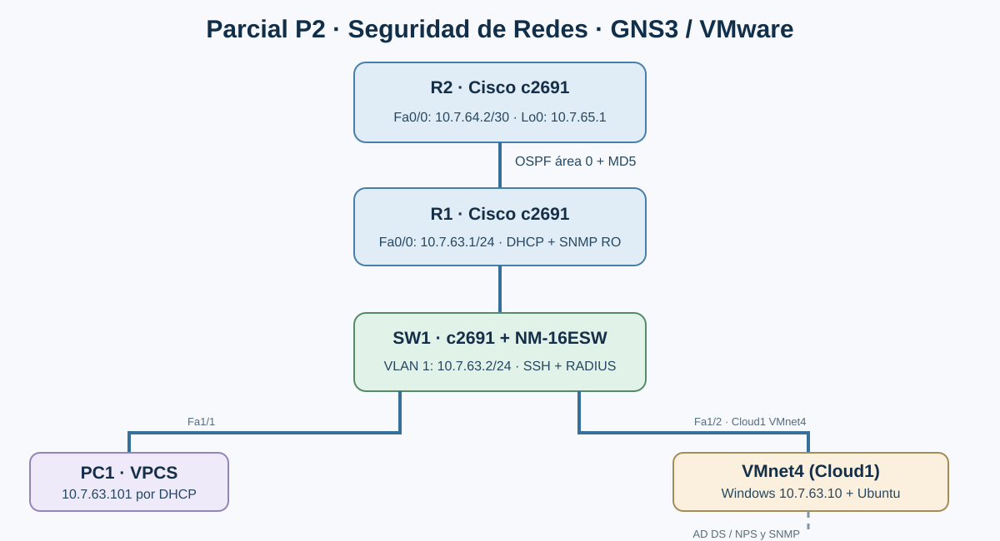

**Topología implementada en GNS3:** R2 → R1 → SW1, con PC1 y Cloud1 conectados al switch. Cloud1 enlaza la LAN con las máquinas virtuales de VMware.

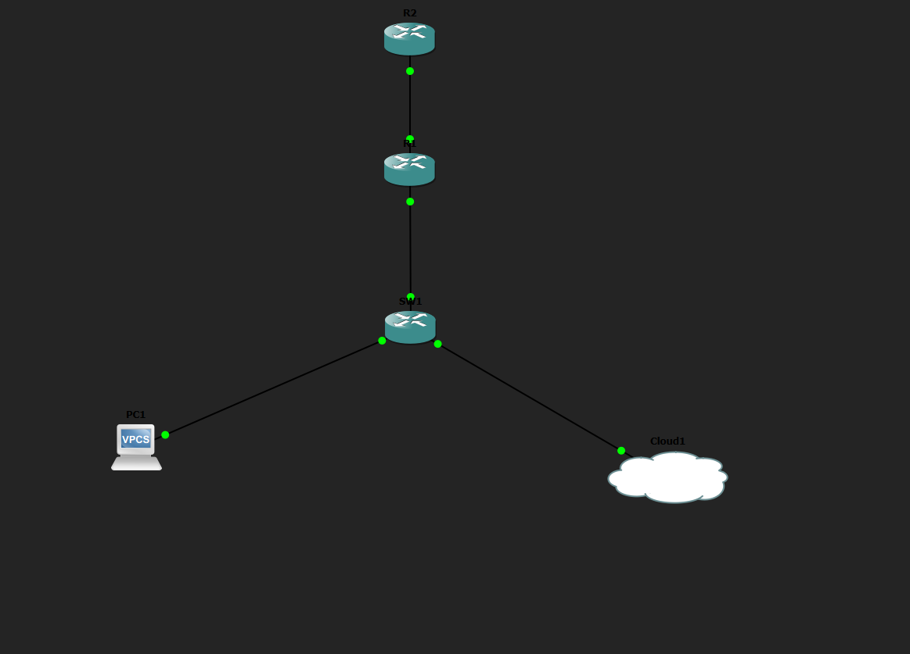

| Equipo | Dirección | Función |
|---|---|---|
| R1, Fa0/0 | `10.7.63.1/24` | Enlace LAN, servidor DHCP y comunidad SNMP de solo lectura |
| R1, Fa0/1 | `10.7.64.1/30` | OSPF con autenticación MD5 hacia R2 |
| R2, Fa0/0 | `10.7.64.2/30` | Vecino OSPF de R1 |
| R2, Loopback0 | `10.7.65.1/32` | Red de prueba anunciada mediante OSPF |
| SW1, VLAN 1 | `10.7.63.2/24` | Conmutación y administración mediante SSH y RADIUS |
| Windows Server | `10.7.63.10/24` | Controlador `lab.local`, Active Directory y NPS |
| Ubuntu Server | Cliente DHCP en la LAN | Verificación SNMP y servidor Zabbix |
| PC1 | `10.7.63.101/24` (concesión observada) | Cliente DHCP y pruebas de conectividad |

**Precisiones sobre la infraestructura:** SW1 fue implementado con un Cisco c2691 y módulo EtherSwitch `NM-16ESW` debido a problemas al iniciar IOSvL2 en GNS3. **Este equipo no es IOSvL2**. La diferencia debe informarse al docente para que determine si admite la sustitución. Windows Server y Ubuntu están en la red privada VMware VMnet4 mediante Cloud1.

## 1. SNMP: solo lectura

En R1 se configuró SNMPv2c con comunidad de lectura (`RO`) y ACL 15 que permite la red `10.7.63.0/24`. Desde Ubuntu se realizó una consulta de lectura a `sysLocation.0`. El intento de escritura mediante `snmpset` devolvió **`noAccess`** y la lectura posterior mostró el valor original `LAB-PARCIAL-R1`, lo que demuestra que la modificación fue rechazada.

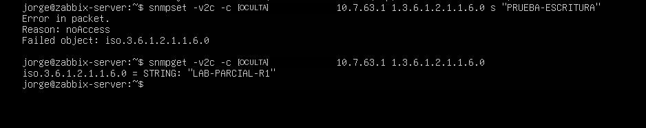

## 2. Acceso administrativo por SSH

R1 y SW1 utilizan `ip ssh version 2`, usuario local con `secret`, autenticación y autorización por RADIUS para las líneas VTY, y `transport input ssh` sin Telnet. El acceso de consola tiene autenticación local de respaldo. Se ejecutaron sesiones SSH contra `10.7.63.1` y `10.7.63.2`. Por compatibilidad con el IOS 12.4 de laboratorio, el cliente SSH tuvo que admitir algoritmos criptográficos antiguos únicamente durante estas pruebas; esto constituye una limitación de seguridad del entorno.

## 3. Direccionamiento y conectividad

La red LAN es `10.7.63.0/24`. Se verificaron las comunicaciones entre PC1, R1 y SW1, y desde Windows Server hacia R1 y SW1.

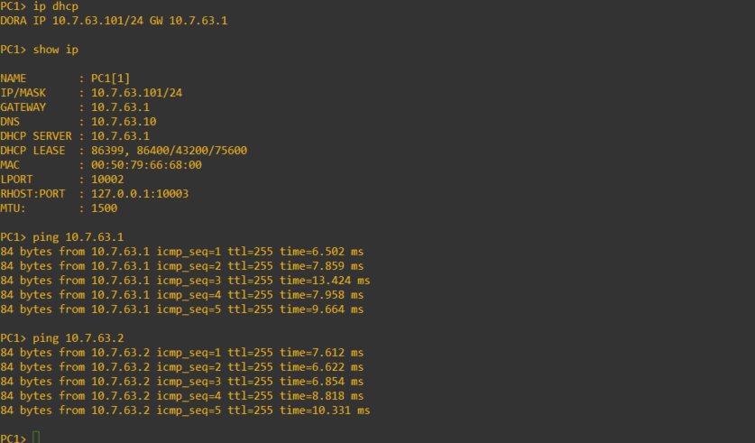

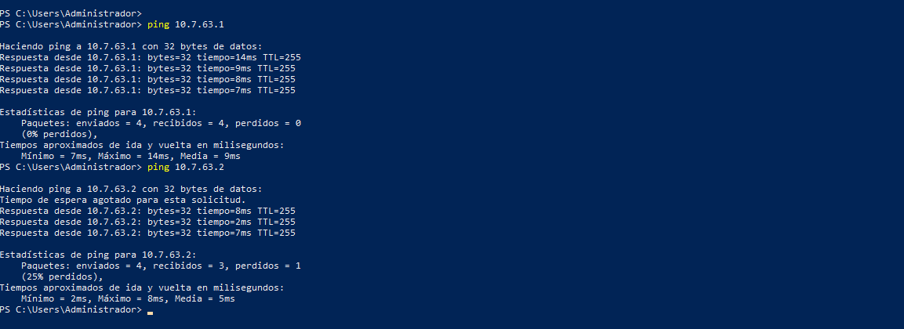

## 4. OSPF con autenticación

R1 y R2 forman vecindad OSPF de **área 0** en estado `FULL`, con autenticación `Message digest authentication enabled` en sus interfaces. La prueba en R1 muestra la ruta aprendida `10.7.65.1/32` a través de `10.7.64.2` y el ping de **5/5** respuestas; R2 aprendió la red LAN `10.7.63.0/24` y completó un ping de **5/5** respuestas a R1. La autenticación MD5 aporta autenticación e integridad a los mensajes OSPF, no confidencialidad del contenido.

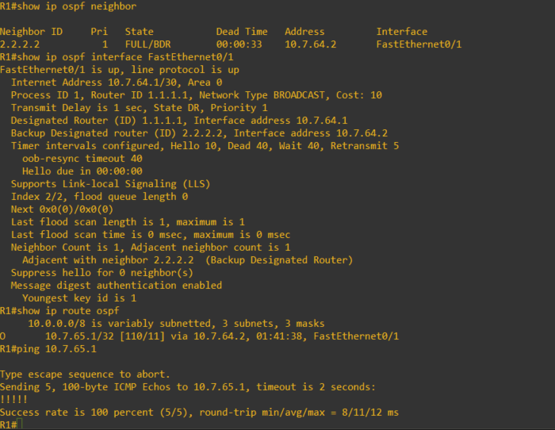

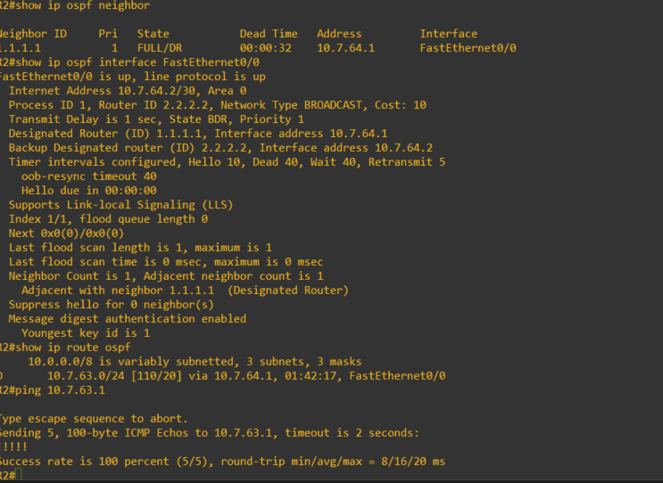

## 5. Hardening relacionado con recomendaciones CIS Cisco IOS

Se seleccionaron controles de protección del plano de administración y reducción de la superficie de ataque. Estas medidas se aplicaron y se comprobaron mediante la configuración final y comandos `show` en los tres equipos; no se afirma cumplimiento integral del benchmark CIS.

| Control aplicado | Justificación | Verificación observada |
|---|---|---|
| SSHv2 y `transport input ssh` | Evitar acceso Telnet sin cifrado | `show ip ssh` y configuración de VTY |
| `exec-timeout 5 0` en VTY | Cerrar sesiones administrativas inactivas | `show running-config` en VTY |
| `ip ssh time-out 60` | Limitar duración de intentos de conexión SSH | `show ip ssh` |
| TCP keepalives entrantes y salientes | Detectar conexiones TCP interrumpidas | `service tcp-keepalives-in/out` |
| `no ip source-route` | Evitar uso de IP Source Routing | `show running-config` |
| `no ip http server` y `no ip http secure-server` | Retirar servidores web innecesarios | `show running-config` |
| `logging buffered 8192` | Conservar eventos locales para diagnóstico | `show logging` |
| Usuario `secret` y `service password-encryption` | Proteger la configuración almacenada frente a exposición casual | `show running-config` con secretos ocultos en la publicación |

**Limitaciones:** IOS 12.4 utiliza algoritmos SSH heredados y claves RSA antiguas; algunos parámetros, incluidos `ip ssh authentication-retries`, pueden estar activos por defecto sin aparecer como línea explícita en `show running-config`. No se certificó cumplimiento completo del benchmark.

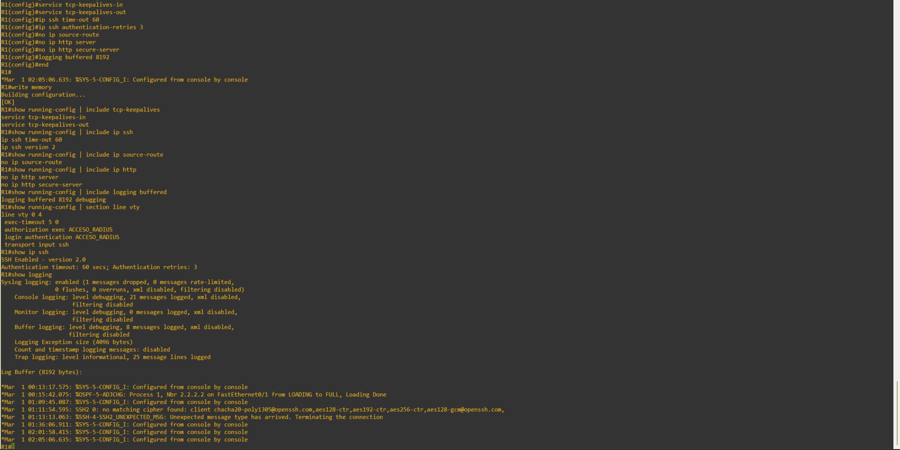

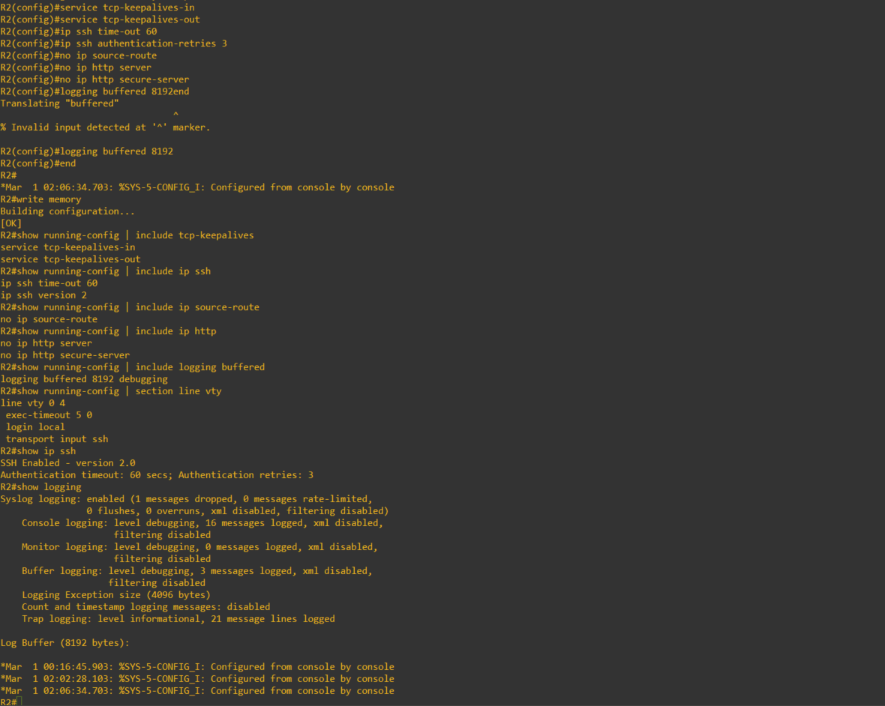

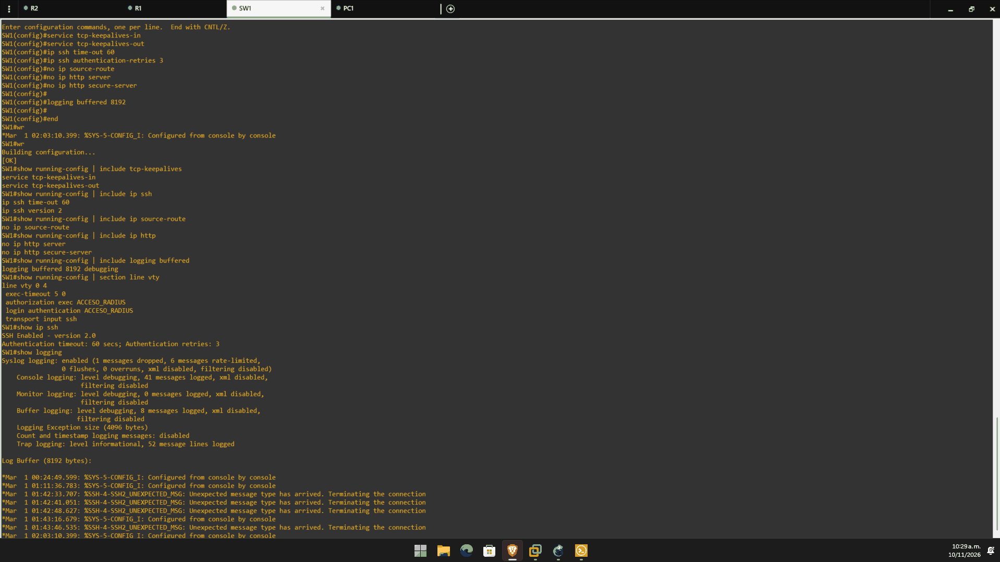

## 6. DHCP en el router

R1 ejecuta el pool `LAN-PARCIAL` para `10.7.63.0/24`, con puerta de enlace `10.7.63.1` y DNS `10.7.63.10`. Se observaron dos concesiones, `10.7.63.100` y `10.7.63.101`. PC1 obtuvo `10.7.63.101/24` y respondió a los pings dirigidos a R1 y SW1.

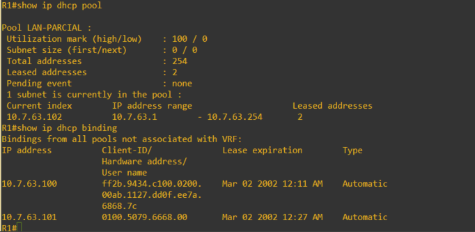

## 7. Active Directory y NPS (RADIUS)

En Windows Server se usó el dominio `lab.local` con tres grupos de seguridad (`NIVEL_0`, `NIVEL_5` y `NIVEL_10`) y usuarios individuales de prueba. NPS autorizó acceso administrativo por RADIUS enviando los atributos Cisco-AVPair `shell:priv-lvl=0`, `shell:priv-lvl=5` y `shell:priv-lvl=10`.

**Configuración NPS verificada:** las directivas `POLITICA_NIVEL_0`, `POLITICA_NIVEL_5` y `POLITICA_NIVEL_10` están habilitadas y conceden acceso. Los clientes RADIUS `R1` (`10.7.63.1`) y `SW1` (`10.7.63.2`) figuran habilitados como dispositivos Cisco.

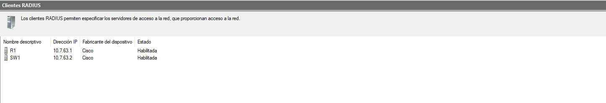

Se comprobó expresamente en las sesiones SSH que **usuario5 obtuvo nivel 5** y **usuario10 obtuvo nivel 10** en R1 y SW1. Para **usuario0** se observó un conjunto reducido de comandos y la imposibilidad de ejecutar `show privilege`, coherente con privilegio 0; esa salida por sí sola no declara el número exacto.

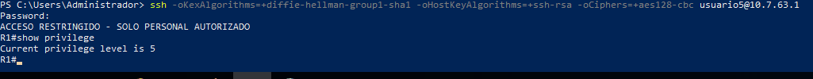

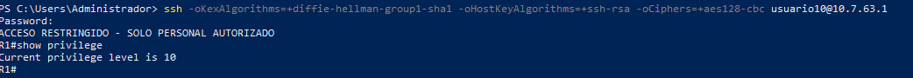

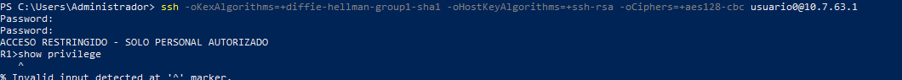

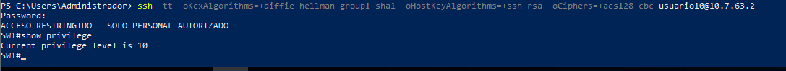

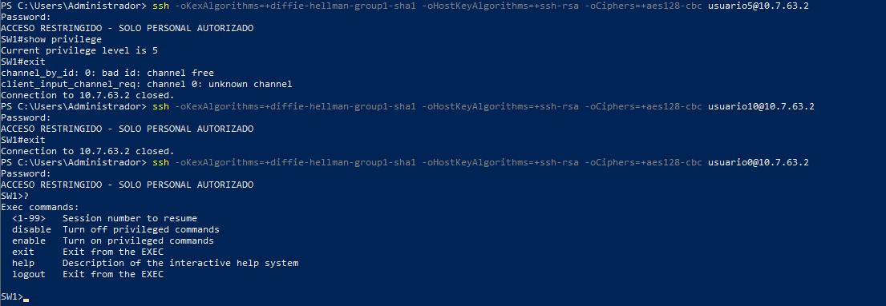

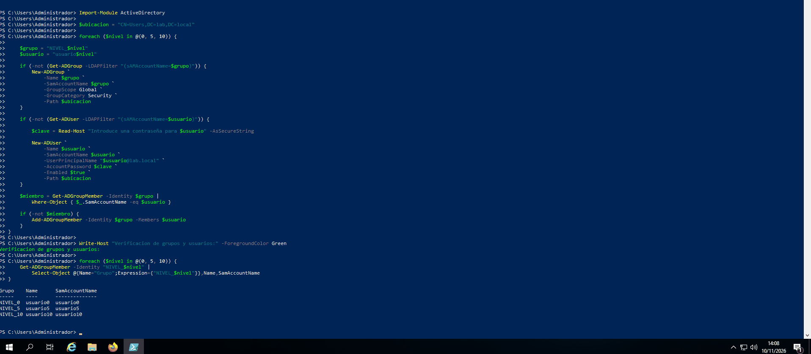

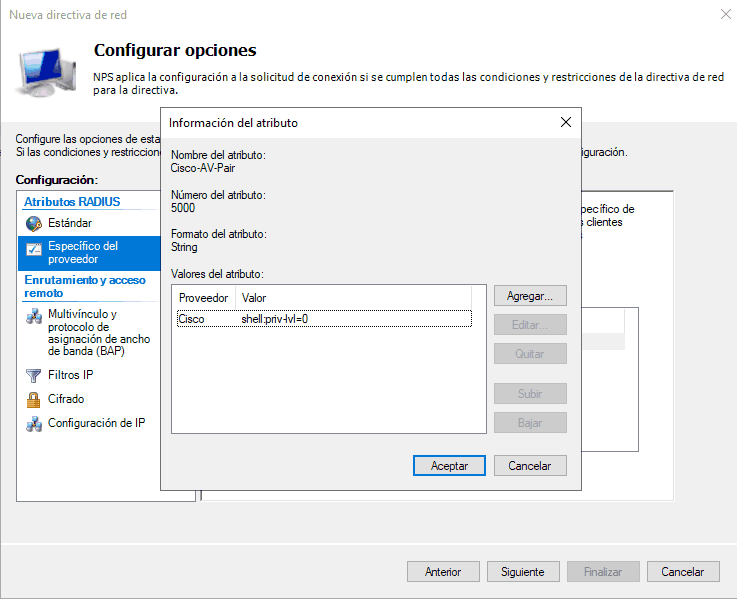

## 8. Archivos de configuración

Las configuraciones incluyen secciones de consola, AUX y VTY, interfaces físicas, VLAN 1, DHCP, OSPF, RADIUS, SNMP y hardening, según aplique. Fueron **reconstruidas a partir de las capturas completas de `show running-config`**, con sustitución de hashes y credenciales por etiquetas de ocultación. Estas etiquetas no se deben ejecutar en equipos reales.

- [R1 — configuración](configuraciones/R1_running-config.txt)
- [R2 — configuración](configuraciones/R2_running-config.txt)
- [SW1 — configuración](configuraciones/SW1_running-config.txt)

### Evidencia del running-config completo, desde `version 12.4` hasta `end`

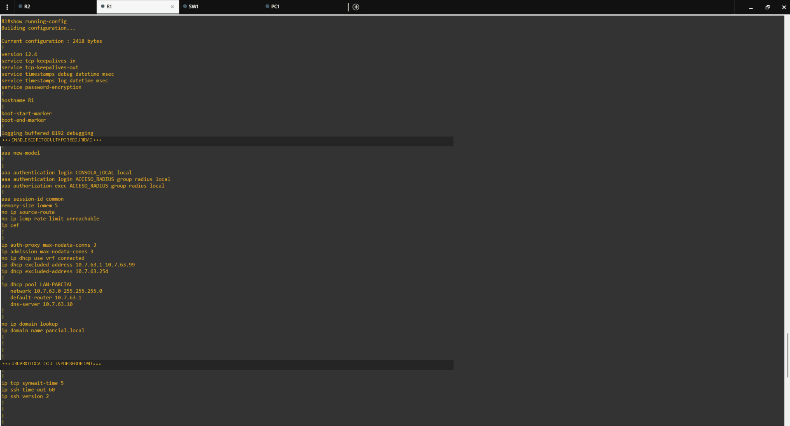
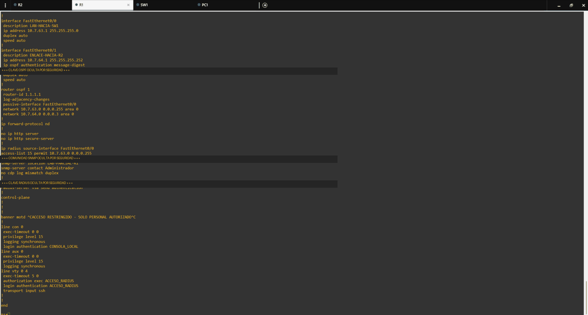
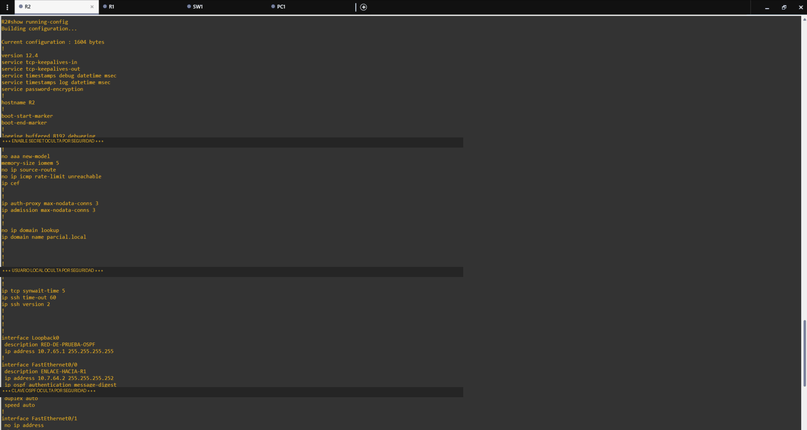
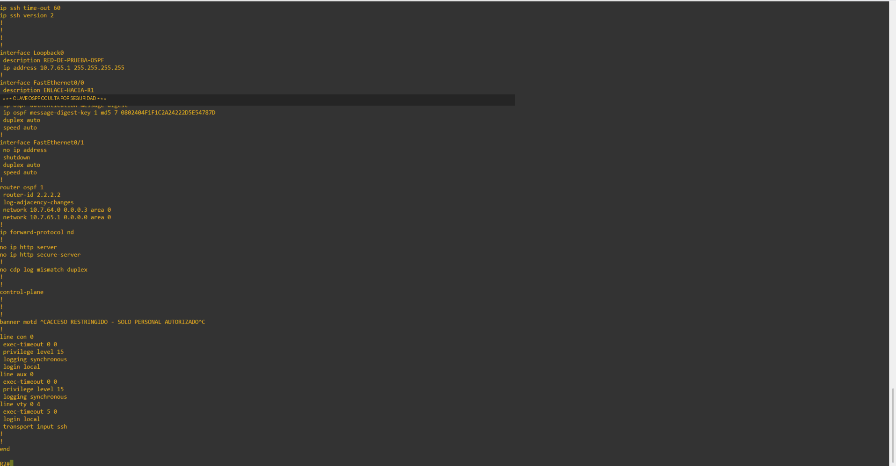
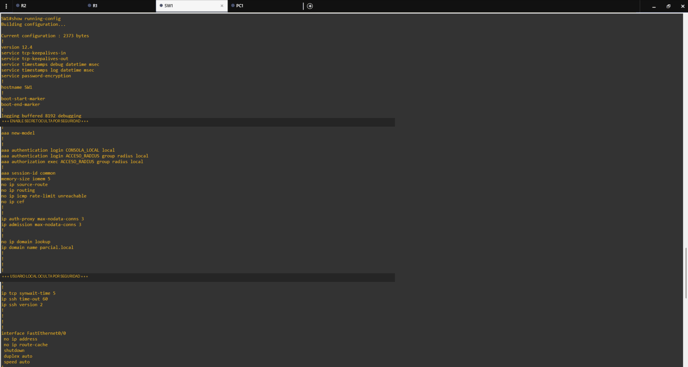
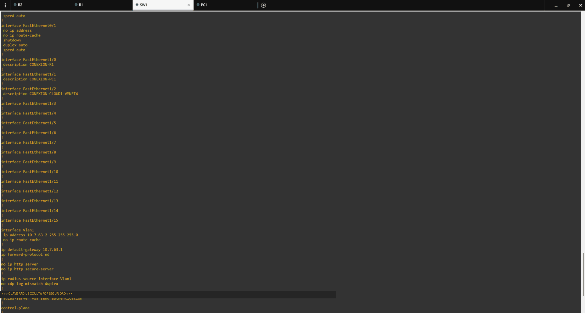
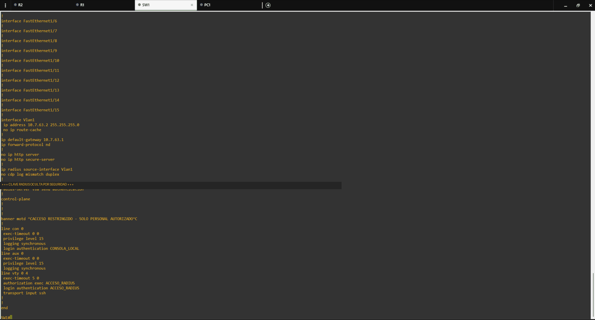

## Conclusión

Se observaron respuestas SNMP con escritura rechazada, conectividad IP, concesiones DHCP, vecindad y rutas OSPF con autenticación MD5, medidas de protección administrativa y niveles diferenciados mediante AD/NPS. La documentación incluye imágenes de las pruebas y copias depuradas de las configuraciones para revisión del profesor.